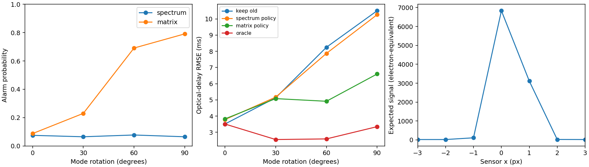

# Reference results

Fixed seeds; 999 training pairs and 800 held-out trials per angle. Ten tests passed. Plot inspected for labels, physical pixel sampling and policy ordering.

| Rotation | Spectrum alarm | Matrix alarm | Keep old RMSE | Spectrum policy RMSE | Matrix policy RMSE | Oracle RMSE |
|---|---|---|---|---|---|---|
| 0° | 7.50% | 8.75% | 3.514 ms | 3.785 ms | 3.829 ms | 3.514 ms |
| 30° | 6.50% | 23.00% | 5.134 ms | 5.174 ms | 5.081 ms | 2.556 ms |
| 60° | 7.75% | 69.12% | 8.250 ms | 7.870 ms | 4.918 ms | 2.594 ms |
| 90° | 6.50% | 79.12% | 10.505 ms | 10.263 ms | 6.602 ms | 3.351 ms |

Thresholds: spectrum 0.792792, matrix 0.807085. The unchanged held-out rates (7.50%, 8.75%) exceed the nominal marginal 5% level. They are retained without reseeding or threshold tuning. Rank calibration averages over training-set randomness; this one set can be liberal. The 800-trial binomial sampling uncertainty is also nonzero (about 0.9–1.0 percentage point standard error at these rates). A deployment requiring reliable conditional false alarms needs a separate calibration study.

At 60°, matrix-minus-spectrum paired MSE is −37.762 ± 5.520 ms² (two MCSE). At 0° it is +0.330 ± 0.245 ms²: unnecessary switches increase risk. At 30° the difference is −0.952 ± 1.280 ms², not a clear improvement. The assumed 60° correction is suboptimal at 90° despite substantial detection. These results establish neither a general optimal detector nor an accuracy specification.

The exact clock-only RMSE is reported separately in JSON; differences from measured RMSE include finite Monte Carlo error and camera fitting noise. No final-clock/camera data are used to select weights. Common 90° coordinate controls agree exactly in this run.

